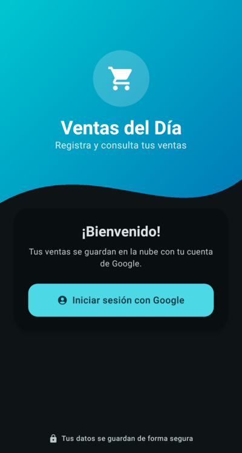
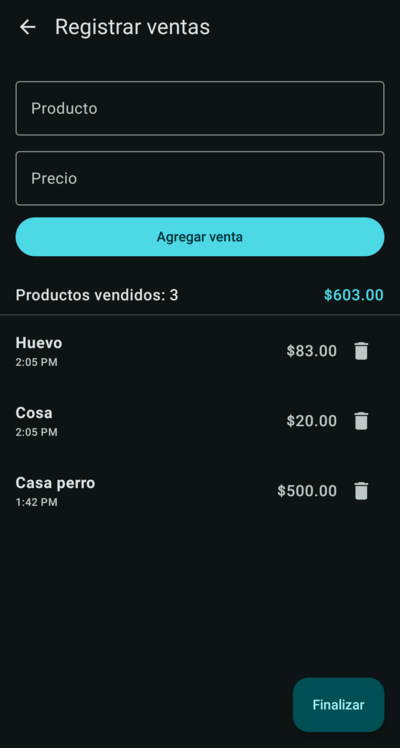
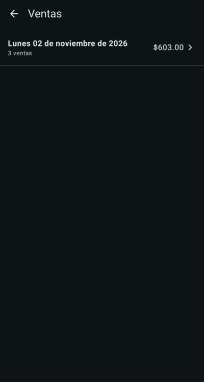
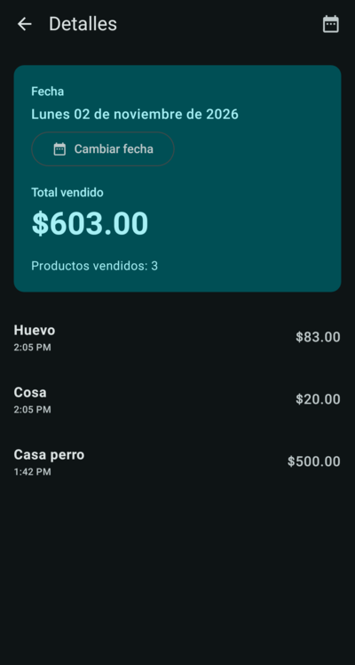
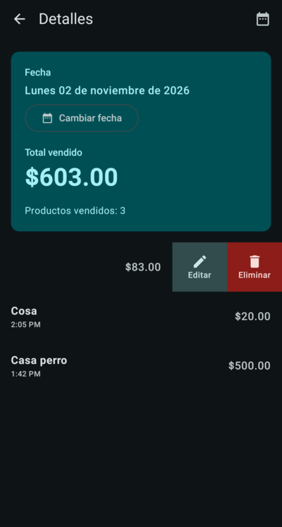

# Ventas sobre ruedas

App Android para registrar las ventas del día y consultarlas después. Las ventas se guardan en la nube (Firebase) con tu cuenta de Google y la app funciona también sin internet: lo registrado sin señal se sincroniza solo al volver la conexión.

## Capturas

| Inicio de sesión | Home | Registrar ventas |
|:---:|:---:|:---:|
|  |  |  |
| **Ventas por día** | **Detalles del día** | **Editar y eliminar** |
|  |  |  |

## Funciones

- **Inicio de sesión con Google.** Las ventas quedan ligadas a tu cuenta, no al teléfono.
- **Registrar ventas:** producto y precio; la fecha y hora se asignan automáticamente.
- **Ver ventas:** lista de los días con ventas, con número de ventas y total de cada día.
- **Detalles del día:** total vendido y lista de ventas. Al deslizar una venta hacia la izquierda aparecen **Editar** y **Eliminar** (con confirmación).
- **Sin internet:** se puede registrar, editar y eliminar sin señal.
- Tema turquesa en modo claro y oscuro.

## Tecnologías

- Kotlin 2.3, Jetpack Compose y Material 3
- Navigation 3
- Firebase Authentication (Google, vía Credential Manager)
- Cloud Firestore
- minSdk 26 (Android 8.0)

## Configuración

El archivo `app/google-services.json` **no está en el repositorio**; sin él la app no compila. Para obtenerlo:

1. En la [consola de Firebase](https://console.firebase.google.com), abre el proyecto (o crea uno) y registra una app Android con el paquete `victor.mexico.ventassobreruedas`.
2. Agrega la huella SHA-1 de tu llave de firma en ⚙️ **Configuración del proyecto → Tus apps → Agregar huella digital**. Para la llave de depuración:
   ```bash
   ./gradlew :app:signingReport
   ```
3. En **Authentication → Método de acceso**, habilita **Google**.
4. Crea la base de datos en **Firestore Database** (modo producción) y publica estas reglas:
   ```
   rules_version = '2';
   service cloud.firestore {
     match /databases/{database}/documents {
       match /users/{uid}/sales/{saleId} {
         allow read, write: if request.auth != null && request.auth.uid == uid;
       }
     }
   }
   ```
5. Descarga `google-services.json` (después de los pasos 2 y 3, para que incluya los datos de Google) y colócalo en `app/`.

## Compilar y probar

```bash
./gradlew :app:assembleDebug        # compilar
./gradlew :app:installDebug         # instalar en un teléfono conectado
./gradlew :app:testDebugUnitTest    # pruebas unitarias
```

También se puede abrir el proyecto en Android Studio y usar **Run ▶**.

## Estructura

```
app/src/main/java/victor/mexico/ventassobreruedas/
├── data/auth/          Inicio de sesión con Google (AuthRepository)
├── data/repository/    Ventas en Firestore (SalesRepository)
├── ui/login/           Pantalla de inicio de sesión
├── ui/home/            Pantalla principal
├── ui/sales/           Registrar ventas
├── ui/days/            Lista de días con ventas
├── ui/summary/         Detalles del día, edición y borrado
├── ui/navigation/      Navegación y control de sesión
├── ui/theme/           Colores y tipografía
└── util/               Formato de dinero y fechas
```

Los datos se guardan en Firestore en `users/{uid}/sales/{saleId}` con los campos `productName`, `priceCents` (precio en centavos) y `createdAt`.
