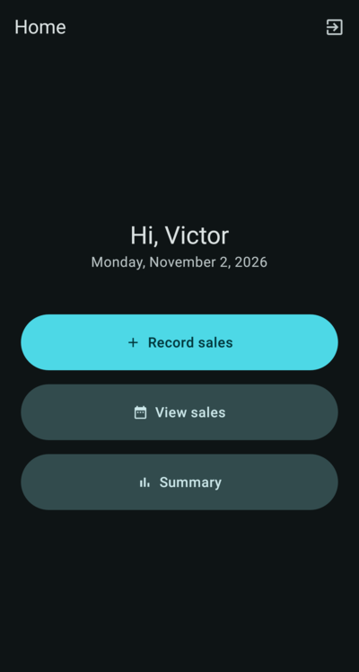
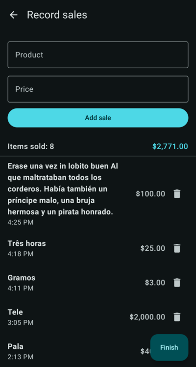
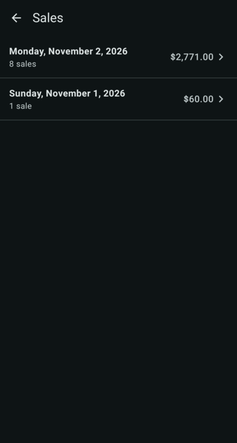
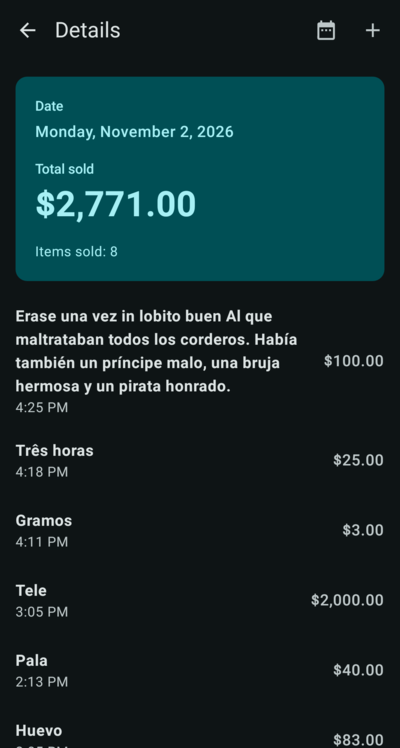
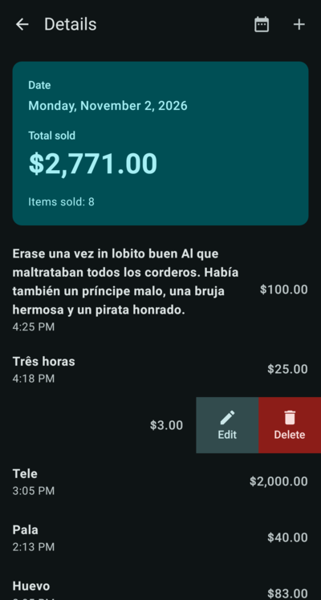
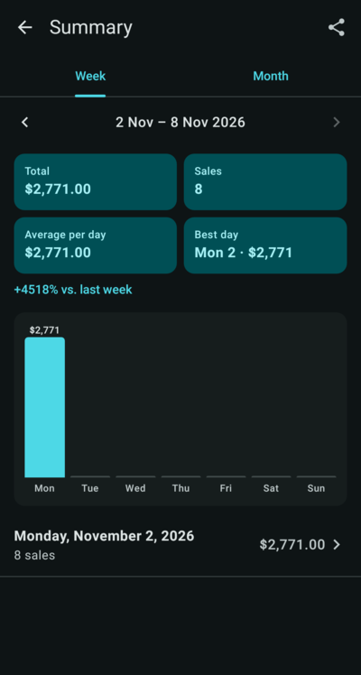
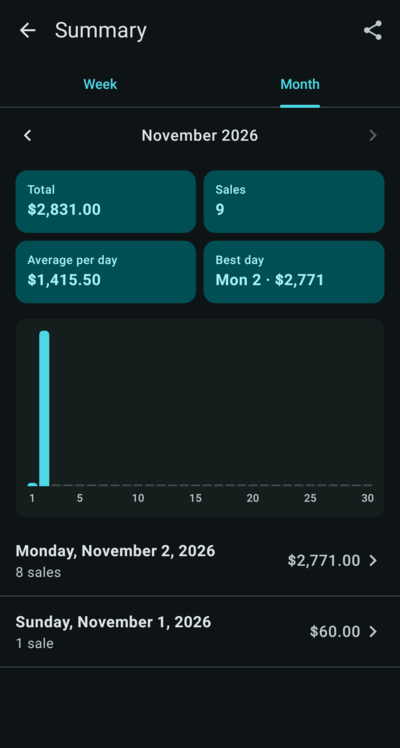
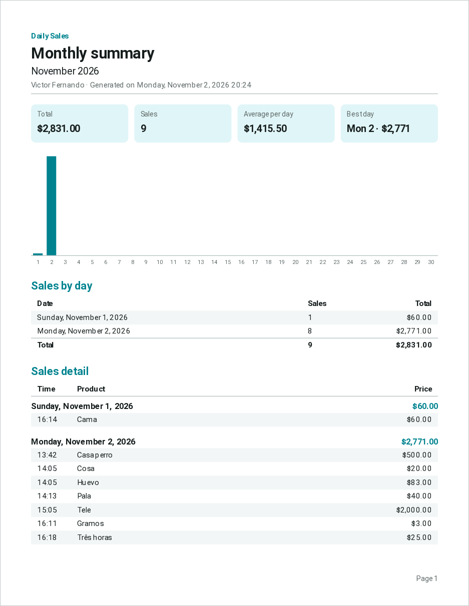

# Ventas sobre ruedas

Android app to record daily sales and review them later. Sales are stored in the cloud (Firebase) under your Google account, and the app also works offline: anything recorded without signal syncs automatically once the connection is back.

## Screenshots

| Home | Record sales | Sales by day |
|:---:|:---:|:---:|
|  |  |  |
| **Day details** | **Edit and delete** | **Weekly summary** |
|  |  |  |
| **Monthly summary** | **PDF report** | |
|  |  | |

## Features

- **Google sign-in.** Sales belong to your account, not to the phone. Signing out asks for confirmation.
- **Record sales:** product and price; date and time are assigned automatically. If you tap **Finish** with a product and price typed in but not yet added, the app asks whether to record that sale first.
- **View sales:** list of days with sales, showing the number of sales and the total for each day.
- **Day details:** total sold and the list of sales for any date. Swipe a sale to the left to reveal **Edit** and **Delete** (with confirmation). The **+** button records sales on the selected date, so you can add sales for past days.
- **Summary:** weekly (Monday–Sunday) and monthly views with total, number of sales, average per day with sales, best day and the change versus the previous period, plus a bar chart with one bar per day. Tap a bar or a day to open its details.
- **PDF report:** share the selected week or month as a PDF (totals, chart, sales by day and every sale with its time and price) through WhatsApp, email, Drive or any other app.
- **Offline:** sales can be recorded, edited and deleted without signal.
- Turquoise theme in light and dark mode.
- **Languages:** Spanish, English and Russian. The app follows the phone's language (any other language falls back to Spanish). Amounts are always shown in Mexican pesos (`$`).

## Tech stack

- Kotlin 2.3, Jetpack Compose and Material 3
- Navigation 3
- Firebase Authentication (Google, via Credential Manager)
- Cloud Firestore
- `android.graphics.pdf.PdfDocument` for the PDF report (no extra libraries)
- minSdk 26 (Android 8.0)

## Setup

The file `app/google-services.json` is **not in the repository**; the app won't build without it. To get it:

1. In the [Firebase console](https://console.firebase.google.com), open the project (or create one) and register an Android app with the package `victor.mexico.ventassobreruedas`.
2. Add your signing key's SHA-1 fingerprint under ⚙️ **Project settings → Your apps → Add fingerprint**. For the debug key:
   ```bash
   ./gradlew :app:signingReport
   ```
3. Under **Authentication → Sign-in method**, enable **Google**.
4. Create the database in **Firestore Database** (production mode) and publish these rules:
   ```
   rules_version = '2';
   service cloud.firestore {
     match /databases/{database}/documents {
       match /users/{uid}/sales/{saleId} {
         allow read, write: if request.auth != null && request.auth.uid == uid;
       }
     }
   }
   ```
5. Download `google-services.json` (after steps 2 and 3, so it includes the Google sign-in data) and place it in `app/`.

## Build and test

```bash
./gradlew :app:assembleDebug        # build
./gradlew :app:installDebug         # install on a connected phone
./gradlew :app:testDebugUnitTest    # unit tests
./gradlew :app:lintDebug            # Android lint
```

You can also open the project in Android Studio and use **Run ▶**.

## Project structure

```
app/src/main/java/victor/mexico/ventassobreruedas/
├── data/auth/          Google sign-in (AuthRepository)
├── data/repository/    Sales in Firestore (SalesRepository) and period totals (PeriodSummary)
├── export/             PDF report generation and sharing (ReportPdf)
├── ui/login/           Sign-in screen
├── ui/home/            Home screen
├── ui/sales/           Record sales
├── ui/days/            List of days with sales
├── ui/summary/         Day details, editing and deleting
├── ui/report/          Weekly/monthly summary and bar chart
├── ui/navigation/      Navigation and session handling
├── ui/theme/           Colors and typography
└── util/               Money, date and period formatting
```

Data is stored in Firestore at `users/{uid}/sales/{saleId}` with the fields `productName`, `priceCents` (price in cents) and `createdAt`.
